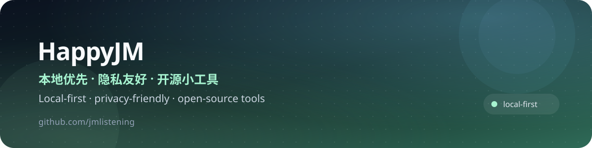

  

  
  
  
  

你好，我是 HappyJM 👋 
在做照片、论文和数据方向的本地优先工具。 
Building local-first tools for photos, papers and data.

## 🧭 关于我 / About

- **本地优先**：能留在设备上的数据，就不上传；能离线运行的，就不依赖云端。
- **隐私友好**：没有账号、没有埋点、没有隐藏上传。
- **可验证**：README 写清楚边界，测试和演示数据可复现。

I build small, auditable tools that keep your data on your device. No accounts, no tracking, no hidden uploads.

## 🚀 精选项目 / Featured Projects

<table>
<tr>
<td width="50%" valign="top">

<h3><a href="https://github.com/jmlistening/id-photo-studio">🪪 ID Photo Studio</a></h3>

证件照尺寸 / 换底 / 压 KB，纯前端本地处理，离线 PWA。 
A privacy-first ID photo studio that runs entirely in your browser.

<code>Vanilla JS</code> <code>MediaPipe</code> <code>PWA</code>

<a href="https://jmlistening.github.io/id-photo-studio/"><strong>▶ 在线试用 / Live Demo</strong></a>

</td>
<td width="50%" valign="top">

<h3><a href="https://github.com/jmlistening/paperlens">📚 PaperLens</a></h3>

基于 RAG + Agent 的个性化论文发现、证据问答与可审计每日推送。 
Personalized arXiv discovery, evidence-grounded Q&amp;A, and auditable daily digests with RAG + Agent.

<code>Python</code> <code>Streamlit</code> <code>RAG</code> <code>Agent</code>

</td>
</tr>
<tr>
<td width="50%" valign="top">

<h3><a href="https://github.com/jmlistening/ai-cutout-studio">✂️ Cutout Studio</a></h3>

本地优先的 AI 抠图工作台：批量队列、透明 PNG 导出、零构建前端。 
A local-first AI background-removal workbench with batch queue, alpha PNG export and a zero-build frontend.

<code>FastAPI</code> <code>Volcengine</code> <code>Pillow</code>

</td>
<td width="50%" valign="top">

<h3><a href="https://github.com/jmlistening/csv-doctor">🩺 CSV Doctor</a></h3>

轻量 CSV / Excel 数据质量工具：可解释分析、可视化与安全清洗。 
A lightweight CSV &amp; Excel data quality toolkit with explainable analysis, visualization and safe cleaning.

<code>Python</code> <code>Streamlit</code> <code>Pandas</code>

</td>
</tr>
</table>

## 🧰 技术栈 / Tech Stack

  
  
  
  
  
  
  
  

## 📊 GitHub 数据 / Stats

  

## 🌱 最近在做 / Currently

- 把本地优先的工具做得更好用、更可验证。
- Making local-first tools more usable and verifiable.

## 🤝 联系 / Connect

- GitHub: [@jmlistening](https://github.com/jmlistening)
- 如果项目对你有帮助，欢迎 Star ⭐ 
  If a project helps you, a star is appreciated.

感谢访问 · Thanks for visiting

